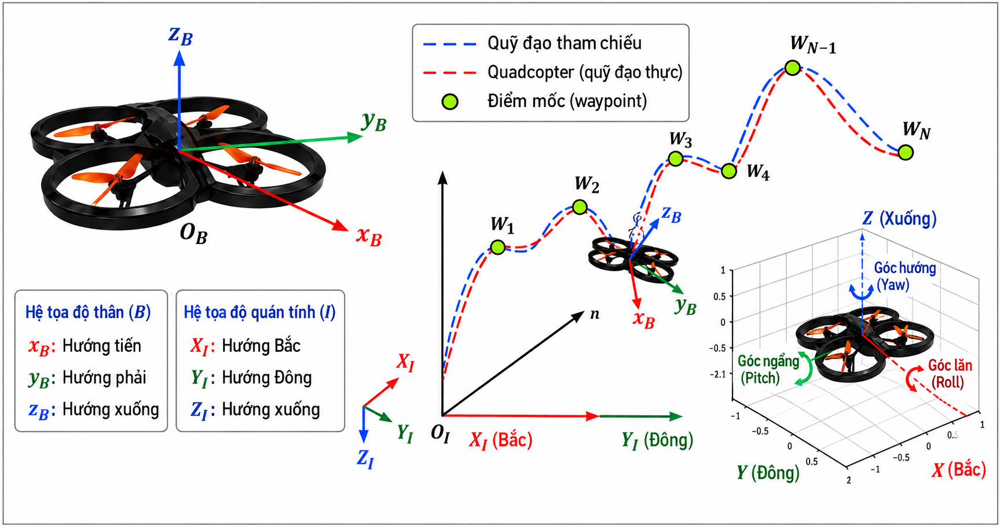
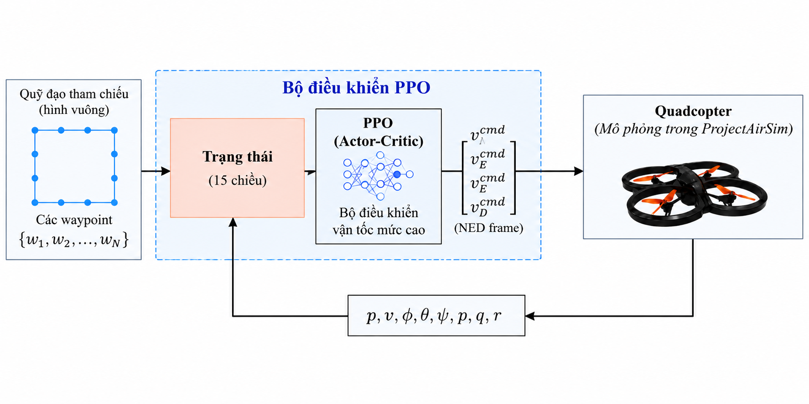
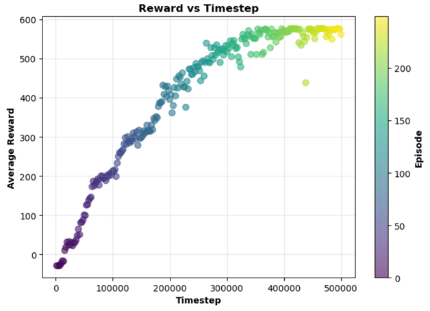

# Ứng dụng thuật toán PPO trong điều khiển quadcopter bám quỹ đạo 

**Tác giả:** Phạm Thị Lý; Nguyễn Vinh Hoàng

## Tóm tắt

Bài báo này trình bày phương pháp điều khiển bám quỹ đạo waypoint cho quadcopter ứng dụng thuật toán Proximal Policy Optimization (PPO). Tác nhân PPO được xây dựng theo kiến trúc Actor–Critic, với trạng thái đầu vào gồm sai lệch vị trí tới waypoint hiện tại và kế tiếp, vận tốc tuyến tính, tư thế và vận tốc góc của quadcopter; đầu ra của chính sách là các lệnh vận tốc theo hệ tọa độ North–East–Down. Hàm phần thưởng gồm bốn thành phần: phần thưởng đạt waypoint, phần phạt vi phạm điều kiện an toàn, phần thưởng tiếp cận waypoint và phần thưởng căn chỉnh hướng vận tốc. Tác nhân được huấn luyện, đánh giá trong môi trường ProjectAirSim trên quỹ đạo hình vuông gồm chuỗi waypoint và phương pháp MoveOnPath sử dụng thuật toán carrot-following được sử dụng làm tham chiếu. Kết quả mô phỏng cho thấy tác nhân PPO học cách điều khiển quadcopter bám quỹ đạo thành công ,và có đáp ứng vị trí nhanh hơn và đạt sai số bám quỹ đạo thấp hơn phương pháp tham chiếu trong điều kiện khảo sát. Tuy nhiên, đáp ứng tư thế của PPO biến lớn hơn đặc biệt tại các vị trí cần quadcopter chuyển hướng.

### Từ khóa

quadcopter, bám quỹ đạo, học tăng cường sâu, Proximal Policy Optimization, ProjectAirSim

## Giới thiệu

Quadcopter ngày càng được ứng dụng trong nhiều nhiệm vụ như kiểm tra cơ sở hạ tầng, nông nghiệp thông minh, và tìm kiếm cứu nạn \[1, 2, 3\]. Trong các ứng dụng này, khả năng bám theo quỹ đạo xác định trước là một yêu cầu quan trọng đối với quá trình vận hành tự động. Tuy nhiên, điều khiển bám quỹ đạo quadcopter vẫn là một bài toán khó do hệ có động lực học phi tuyến, nhiều biến trạng thái liên kết, và đặc tính thiếu dẫn động \[4, 5\].

Nhiều phương pháp điều khiển đã được nghiên cứu cho bài toán này, bao gồm PID và các biến thể \[6\], LQR \[7\], điều khiển dự báo mô hình \[8\], điều khiển trượt, và các phương pháp phi tuyến bền vững \[9, 10\]. Các phương pháp này có thể đạt chất lượng bám tốt trong những điều kiện phù hợp, nhưng thường yêu cầu mô hình động lực học hoặc quá trình thiết kế và hiệu chỉnh tham số điều khiển tương ứng với từng cấu hình hệ thống.

Học tăng cường sâu (Deep Reinforcement Learning, DRL) cung cấp một hướng tiếp cận khác, trong đó chính sách điều khiển được hình thành thông qua quá trình tương tác giữa tác nhân và môi trường thay vì xây dựng trực tiếp luật điều khiển từ mô hình hệ thống. Các nghiên cứu gần đây đã khảo sát DRL cho điều khiển và bám quỹ đạo quadcopter, bao gồm điều khiển tối ưu không mô hình \[11\], so sánh các thuật toán không mô hình cho điều khiển tư thế và bám quỹ đạo \[12\], triển khai điều khiển thời gian thực dựa trên DRL \[13\], cũng như các phương pháp dựa trên DDPG \[14, 15\] và SAC \[16\]. Các kết quả này cho thấy DRL có khả năng xử lý không gian hành động liên tục và là một hướng tiếp cận phù hợp cho các bài toán điều khiển UAV.

Trong nhóm các thuật toán Actor–Critic dành cho không gian hành động liên tục, DDPG \[17\], TD3 \[18\], SAC \[19\], và Proximal Policy Optimization (PPO) \[20\] là những phương pháp được sử dụng phổ biến. Trong nghiên cứu này, PPO được lựa chọn để xây dựng chính sách điều khiển bám quỹ đạo waypoint cho quadcopter trong môi trường ProjectAirSim. Tác nhân sử dụng trạng thái chuyển động của phương tiện và thông tin tương đối tới waypoint hiện tại và kế tiếp để sinh lệnh vận tốc theo ba trục của hệ tọa độ North–East–Down (NED). Hàm phần thưởng gồm bốn thành phần: phần thưởng đạt waypoint, phần phạt vi phạm điều kiện an toàn, phần thưởng tiếp cận waypoint và phần thưởng căn chỉnh hướng vận tốc.

Các đóng góp chính của nghiên cứu gồm:

- Xây dựng tác nhân PPO cho bài toán bám quỹ đạo waypoint của quadcopter với không gian trạng thái 15 chiều và đầu ra là lệnh vận tốc theo hệ tọa độ NED.

- Thiết kế hàm phần thưởng gồm phần thưởng đạt waypoint, phần phạt vi phạm điều kiện an toàn, phần thưởng tiếp cận waypoint và phần thưởng căn chỉnh hướng vận tốc.

- Đánh giá chất lượng điều khiển quadcopter bám quỹ đạo của tác nhân PPO thông qua thời gian hoàn thành, RMSE, và MAE, đồng thời sử dụng MoveOnPath trong ProjectAirSim làm phương pháp tham chiếu.

## Xây dựng bài toán

Mục tiêu điều khiển là đưa quadcopter lần lượt đi qua chuỗi waypoint $\mathcal{W} = \{\mathbf{w}_1, \ldots, \mathbf{w}_N\}$, như minh họa trong Hình [1](#fig:problem-formulation), trong không gian ba chiều. Waypoint thứ $i$, $\mathbf{w}_i = [x_i, y_i, z_i]^{\mathsf{T}}$, và vị trí của quadcopter tại thời điểm $t$, $\mathbf{p}_t = [x_t, y_t, z_t]^{\mathsf{T}}$, đều được biểu diễn trong hệ tọa độ quán tính North–East–Down (NED).

<figure id="fig:problem-formulation" data-latex-placement="H">

<figcaption>Mô hình bài toán bám quỹ đạo waypoint của quadcopter.</figcaption>
</figure>

Trong Hình [1](#fig:problem-formulation), chuyển động của quadcopter được mô tả thông qua hai hệ tọa độ: hệ tọa độ quán tính $\{I\}$ và hệ tọa độ thân $\{B\}$. Hệ tọa độ quán tính được sử dụng để mô tả vị trí và quỹ đạo bay của quadcopter trong không gian toàn cục, với các trục $X_I$, $Y_I$, và $Z_I$ lần lượt tương ứng với các hướng North, East, và Down. Trong khi đó, hệ tọa độ thân gắn trực tiếp với quadcopter gồm các trục $x_B$, $y_B$, và $z_B$, dùng để mô tả hướng chuyển động và tư thế của phương tiện.

## Thiết kế bộ điều khiển ứng dụng thuật toán PPO

<figure id="fig:ppo-architecture" data-latex-placement="H">

<figcaption>Kiến trúc điều khiển cho bài toán bám quỹ đạo của quadcopter.</figcaption>
</figure>

Kiến trúc điều khiển được trình bày trong Hình [2](#fig:ppo-architecture). Trong đó tác nhân PPO đóng vai trò bộ điều khiển cấp cao, sử dụng thông tin trạng thái của quadcopter và quỹ đạo tham chiếu làm đầu vào để tính toán và trả về lệnh vận tốc theo hệ tọa độ NED. Các lệnh vận tốc này được truyền tới bộ điều khiển bay tích hợp trong ProjectAirSim, nơi thực hiện các vòng điều khiển cấp thấp. Trong quá trình hoạt động, các trạng thái chuyển động gồm vị trí, vận tốc, góc Euler và vận tốc góc sẽ luôn được cập nhật và phản hồi về bộ điều khiển PPO từ đó hình thành vòng điều khiển kín.

### Thiết kế không gian trạng thái

Không gian trạng thái được thiết kế nhằm cung cấp cho tác nhân PPO các thông tin cần thiết để hoàn thành bài toán. Trạng thái của quadcopter được biểu diễn bởi vectơ

$$
\begin{aligned}
\mathbf{s}_t = \bigl[&d_x^i, d_y^i, d_z^i,
 d_x^{i+1}, d_y^{i+1}, d_z^{i+1},\\
 &v_x, v_y, v_z, \phi, \theta, \psi,
 \dot{\phi}, \dot{\theta}, \dot{\psi}\bigr]^{\mathsf{T}}.
\end{aligned}
$$

Trong đó:

- $d_x^i$, $d_y^i$, và $d_z^i$ là các thành phần của vectơ sai lệch vị trí tương đối từ quadcopter đến waypoint thứ $i$ theo ba trục của hệ tọa độ NED (North–East–Down), được xác định bởi

  $$
  \mathbf{d}_i = \boldsymbol{\omega}_i - \mathbf{p}_t,
  $$

  trong đó $\mathbf{p}_t = [x, y, z]^{\mathsf{T}} \in \mathbb{R}^3$ là vị trí của quadcopter tại thời điểm $t$, và $\boldsymbol{\omega}_i = [x_{\omega}, y_{\omega}, z_{\omega}]^{\mathsf{T}} \in \mathbb{R}^3$ là vị trí của waypoint thứ $i$;

- $d_x^{i+1}$, $d_y^{i+1}$, và $d_z^{i+1}$ là các thành phần của vectơ sai lệch vị trí tương đối từ quadcopter đến waypoint thứ $i+1$;

- $v_x$, $v_y$, và $v_z$ là các thành phần vận tốc tuyến tính của quadcopter theo ba trục tọa độ;

- $\phi$, $\theta$, và $\psi$ lần lượt là các góc roll, pitch, và yaw mô tả tư thế của quadcopter tại thời điểm $t$;

- $\dot{\phi}$, $\dot{\theta}$, và $\dot{\psi}$ là các vận tốc góc quanh các trục roll, pitch, và yaw tương ứng.

### Thiết kế không gian hành động

Không gian hành động của tác nhân PPO được thiết kế dưới dạng không gian liên tục (continuous action space). Vectơ hành động gồm ba thành phần:

$$
\mathbf{a}_t = \left[v_N^{\mathrm{cmd}}, v_E^{\mathrm{cmd}}, v_D^{\mathrm{cmd}}\right]^{\mathsf{T}}.
$$

Trong đó, $v_N^{\mathrm{cmd}}$, $v_E^{\mathrm{cmd}}$, và $v_D^{\mathrm{cmd}}$ lần lượt là các lệnh vận tốc mong muốn theo ba trục North, East, và Down của hệ tọa độ NED.

Trong nghiên cứu này, tác nhân PPO không trực tiếp gửi lệnh lực đẩy, mô-men điều khiển, hoặc tốc độ quay của từng rotor. Thay vào đó, chính sách đã học tính toán và gửi lệnh vận tốc đến bộ điều khiển bay tích hợp trong ProjectAirSim để điều khiển quadcopter. Vì vậy, bộ điều khiển PPO được xem là một chính sách sinh lệnh vận tốc mức cao (high-level velocity-command policy), trong khi việc ổn định tư thế và chuyển đổi lệnh vận tốc thành các tác động điều khiển mức thấp được thực hiện bởi bộ điều khiển bay bên trong môi trường mô phỏng.

Để bảo đảm tín hiệu điều khiển nằm trong phạm vi phù hợp, mỗi thành phần hành động được giới hạn bởi

$$
v_N^{\mathrm{cmd}}, v_E^{\mathrm{cmd}}, v_D^{\mathrm{cmd}} \in [-3.0, 3.0]~\mathrm{m/s}.
$$

Giới hạn này được triển khai bằng lớp `Box` của thư viện Gymnasium, bảo đảm rằng các lệnh vận tốc do tác nhân sinh ra không vượt quá phạm vi đã thiết lập trong quá trình huấn luyện và thử nghiệm. Quá trình tương tác giữa tác nhân PPO và môi trường mô phỏng được thực hiện theo cơ chế lock-step với bước thời gian cố định $\Delta t = 0.05$ s, tương ứng với tần số điều khiển $f_c = 1/\Delta t = 20$ Hz.

### Thiết kế hàm phần thưởng

Để tác nhân học được cách hoàn thành bài toán, hàm phần thưởng gồm bốn thành phần sau:

$$
R_{\mathrm{sum}} = r_{\mathrm{waypoint}} + r_{\mathrm{penalty}} + r_{\mathrm{approach}} + r_{\mathrm{align}}.
$$

Trong đó:

- $R_{\mathrm{sum}}$ là tổng phần thưởng tại thời điểm $t$;

- $r_{\mathrm{waypoint}}$ và $r_{\mathrm{penalty}}$ lần lượt là phần thưởng khi quadcopter hoàn thành waypoint và phạt khi quadcopter vi phạm điều kiện an toàn.;

- $r_{\mathrm{approach}}$ là phần thưởng tiếp cận waypoint, khuyến khích quadcopter giảm khoảng cách tới waypoint hiện tại;

- $r_{\mathrm{align}}$ là phần thưởng liên tục khuyến khích quadcopter duy trì hướng chuyển động thẳng hàng với hướng từ vị trí quadcopter đến waypoint.

#### Phần thưởng hoàn thành waypoint

Để khuyến khích quadcopter hoàn thành các waypoint theo đúng thứ tự trên quỹ đạo tham chiếu, phần thưởng có dạng như sau:

$$
r_{\mathrm{waypoint}} =\!
 \begin{cases}
  10, & d(\mathbf{p}_t, \boldsymbol{\omega}_i) < r_{\omega},\ i < n,\\[4pt]
  15\left(1 + \displaystyle\frac{T_{\max}-t}{T_{\max}}\right),
      & d(\mathbf{p}_t, \boldsymbol{\omega}_i) < r_{\omega},\ i = n,\\[8pt]
  0, & \text{ngược lại}.
 \end{cases}
$$

Trong đó, $\mathbf{p}_t \in \mathbb{R}^3$ là vị trí của quadcopter tại thời điểm $t$, $\boldsymbol{\omega}_i \in \mathbb{R}^3$ là waypoint thứ $i$, $T_{\max}$ là số bước tối đa của một episode, $r_{\omega}$ là bán kính xác định quadcopter hoàn thành waypoint, và $d(\mathbf{p}_t, \boldsymbol{\omega}_i)= \left\|\mathbf{p}_t - \boldsymbol{\omega}_i\right\|_2$ là khoảng cách Euclid giữa quadcopter và waypoint mục tiêu. Quadcopter được xác định là đã hoàn thành waypoint mục tiêu khi $d(\mathbf{p}_t, \boldsymbol{\omega}_i) < r_{\omega}$. Khi điều khiển quadcopter đến waypoint trung gian, tác nhân nhận một phần thưởng dương. Nếu hoàn thành waypoint cuối cùng trước khi hết số bước tối đa của episode, tác nhân nhận thêm phần thưởng phụ thuộc vào số bước thời gian còn lại.

#### Phạt vi phạm điều kiện an toàn

Tại mỗi bước thời gian, nếu episode kết thúc sớm do quadcopter va chạm với mặt đất, bị lật, hoặc cách waypoint mục tiêu quá xa, tác nhân bị phạt một giá trị âm lớn:

$$
r_{\mathrm{penalty}} = -30.
$$

Cơ chế này được xem như một ràng buộc an toàn, giúp cho quadcopter tránh được các tình huống nguy hiểm như chạm mặt đất, bị lật khi $|\phi|$ hoặc $|\theta| > \pi/2$, hoặc di chuyển quá xa so với waypoint mục tiêu. Việc sử dụng cùng một mức phạt lớn cho các sự kiện nguy hiểm nhấn mạnh rằng mọi tình huống làm episode kết thúc sớm đều không mong muốn và cần tránh trong quá trình bay. Nếu không xuất hiện sự kiện nguy hiểm, quá trình huấn luyện tiếp tục kiểm tra điều kiện đạt waypoint.

#### Phần thưởng tiếp cận waypoint

Phần thưởng tiếp cận waypoint $r_{\mathrm{approach}}$ được xác định như sau:

$$
r_{\mathrm{approach}} = \max\left\{0,\;5.0\left[
 d(\mathbf{p}_{t-1}, \boldsymbol{\omega}_i)
 - d(\mathbf{p}_t, \boldsymbol{\omega}_i)
 \right]\right\}.
$$

Trong đó, $d(\mathbf{p}_{t-1}, \boldsymbol{\omega}_i)$ và $d(\mathbf{p}_t, \boldsymbol{\omega}_i)$ lần lượt là khoảng cách từ quadcopter đến waypoint thứ $i$ tại các thời điểm $t-1$ và $t$. Phần thưởng tiếp cận waypoint $r_{\mathrm{approach}}$ được thiết kế nhằm khuyến khích quadcopter giảm khoảng cách tới waypoint hiện tại sau mỗi bước thời gian. Theo đó, tác nhân nhận phần thưởng khi khoảng cách tới waypoint hiện tại giảm so với bước thời gian trước; ngược lại, thành phần này bằng $0$ khi quadcopter không tiến gần waypoint.

#### Phần thưởng hiệu chỉnh vận tốc

Thành phần $r_{\mathrm{align}}$ khuyến khích quadcopter duy trì hướng chuyển động thẳng hàng với hướng từ vị trí hiện tại đến waypoint. Phần thưởng có dạng như sau:

$$
r_{\mathrm{align}} = \max\left\{0,\;0.2\,\mathbf{v}_t \cdot
 \frac{\boldsymbol{\omega}_i - \mathbf{p}_t}
 {d(\mathbf{p}_t, \boldsymbol{\omega}_i)}\right\}.
$$

Trong đó $\mathbf{v}_t \in \mathbb{R}^3$ là vectơ vận tốc tuyến tính của quadcopter tại thời điểm $t$. Giá trị phần thưởng là tích vô hướng giữa vectơ vận tốc và vectơ đơn vị hướng tới waypoint. Thành phần này nhận giá trị dương khi vectơ vận tốc có thành phần hướng về waypoint, tương ứng với góc giữa hai vectơ nhỏ hơn $90^\circ$. Khi quadcopter bay vuông góc hoặc theo hướng rời xa waypoint, phần thưởng bằng $0$.

### Mạng Actor–Critic

Bộ điều khiển vận tốc mức cao được xây dựng dựa trên thuật toán Proximal Policy Optimization (PPO) \[20\] với kiến trúc Actor–Critic. Trong đó, mạng Actor thực hiện ánh xạ trạng thái hiện tại của quadcopter thành lệnh vận tốc mong muốn, trong khi mạng Critic ước lượng giá trị của trạng thái nhằm hỗ trợ quá trình cập nhật chính sách.

Cả Actor và Critic đều nhận vectơ trạng thái $\mathbf{s}_t \in \mathbb{R}^{15}$ được xác định trong Phần [II](#sec:problem-formulation) làm đầu vào. Trước khi đưa vào mạng, các thành phần trạng thái được chuẩn hóa nhằm hạn chế ảnh hưởng của sự khác biệt về thang đo giữa các biến quan sát. Mỗi mạng gồm hai lớp ẩn fully connected, mỗi lớp có 64 nơ-ron và sử dụng hàm kích hoạt Tanh.

## Thiết lập mô phỏng và tham số thử nghiệm

### Môi trường mô phỏng

Quá trình huấn luyện và đánh giá bộ điều khiển PPO được thực hiện trong môi trường mô phỏng ProjectAirSim. Môi trường này cung cấp mô hình vật lý thời gian thực cho quadcopter, cho phép mô phỏng trạng thái chuyển động, cảm biến và tương tác động lực học của phương tiện trong không gian ba chiều. Trong mô phỏng, quadcopter có cấu hình dạng chữ X với khối lượng thân xấp xỉ $1.0\,\text{kg}$. Hệ thống động lực gồm bốn rotor bố trí đối xứng, khoảng cách theo hai trục thân là $0.253\,\text{m}$. Mỗi rotor có đường kính $0.2286\,\text{m}$ và tốc độ quay cực đại khoảng $6396\,\text{vòng/phút}$. Hai rotor quay theo chiều kim đồng hồ và hai rotor quay ngược chiều kim đồng hồ nhằm cân bằng mô-men xoắn tổng thể. Các thông số khí động và lực nâng được thiết lập theo cấu hình mô phỏng sử dụng trong ProjectAirSim.

### Tham số huấn luyện PPO

Các tham số huấn luyện chính của bộ điều khiển PPO được trình bày trong Bảng [1](#tab:ppo-hyperparameters).

| **Tham số**                       | **Giá trị**        |
|:----------------------------------|:-------------------|
| Tổng số timestep huấn luyện       | $500{,}000$        |
| Số timestep tối đa mỗi episode    | $400$              |
| Chu kỳ điều khiển $\Delta t$      | $0.05\,\text{s}$   |
| Tần suất cập nhật PPO             | $2000$ timestep    |
| Tốc độ học của actor              | $3 \times 10^{-4}$ |
| Tốc độ học của critic             | $1 \times 10^{-3}$ |
| Số epoch cập nhật $K$             | $5$                |
| Hệ số chiết khấu $\gamma$         | $0.99$             |
| Tham số GAE $\lambda$             | $0.95$             |
| Hệ số clipping $\epsilon$         | $0.2$              |
| Độ lệch chuẩn hành động ban đầu   | $1.0$              |
| Độ lệch chuẩn hành động tối thiểu | $0.1$              |
| Bước giảm độ lệch chuẩn           | $0.01$             |
| Chu kỳ giảm độ lệch chuẩn         | $50$ episode       |
| Số nơ-ron mỗi lớp ẩn              | $64$               |
| Số lớp ẩn Actor/Critic            | $2$                |
| Hàm kích hoạt                     | Tanh               |

Các siêu tham số huấn luyện PPO {#tab:ppo-hyperparameters}

### Phương pháp tham chiếu

Trong nghiên cứu này, chức năng MoveOnPath có sẵn trong ProjectAirSim được sử dụng làm phương pháp tham chiếu để đánh giá chất lượng điều khiển của tác nhân PPO. MoveOnPath thực hiện bám quỹ đạo waypoint dựa trên thuật toán carrot-following với cơ chế lookahead để dẫn hướng quadcopter dọc theo quỹ đạo\[21\]. Trong quá trình đánh giá, vận tốc đặt cho MoveOnPath được giới hạn trong khoảng $[-3,3]\,\text{m/s}$. Hai phương pháp được đánh giá trên cùng quỹ đạo tham chiếu, cùng cấu hình quadcopter và môi trường mô phỏng. Kết quả của MoveOnPath được sử dụng làm cơ sở đối chiếu với PPO thông qua thời gian hoàn thành quỹ đạo và các chỉ tiêu sai số bám.

### Tiêu chí đánh giá

Chất lượng bộ điều khiển được đánh giá dựa trên ba chỉ tiêu chính: thời gian hoàn thành quỹ đạo, sai số căn phương trung bình và sai số tuyệt đối trung bình.

Gọi $\mathbf{p}_k$ là vị trí quadcopter và $\mathbf{p}^{\mathrm{ref}}_k$ là điểm gần nhất trên đường gấp khúc nối các waypoint tại mẫu thứ $k$. Sai số bám quỹ đạo được định nghĩa là $e_k=\lVert\mathbf{p}_k-\mathbf{p}^{\mathrm{ref}}_k\rVert_2$. RMSE và MAE được tính từ thời điểm quadcopter đạt waypoint đầu tiên đến khi hoàn thành waypoint cuối cùng; cùng quy tắc được áp dụng cho PPO và baseline. Giá trị RMSE được xác định bởi

$$
\mathrm{RMSE}=\sqrt{\frac{1}{N}\sum_{k=1}^{N}e_k^2},
$$

trong khi MAE được tính theo

$$
\mathrm{MAE}=\frac{1}{N}\sum_{k=1}^{N}e_k.
$$

## Kết quả

Bộ điều khiển PPO được huấn luyện trên quỹ đạo hình vuông gồm 40 waypoint trong tổng số 500.000 bước thời gian. Kết quả huấn luyện trong Hình 3, cho thấy phần thưởng trung bình tăng dần theo số bước huấn luyện. Ở giai đoạn đầu, giá trị phần thưởng còn thấp do tác nhân chưa học được chính sách chưa hình thành phù hợp. Khi quá trình huấn luyện tiếp tục, phần thưởng tăng rõ rệt và đạt khoảng 500 sau gần 300.000 bước thời gian. Từ khoảng 350.000 bước trở đi, phần thưởng dần đạt ổn định trong khoảng 560–580 và cho tới cuối quá trình huấn luyện. Kết quả này cho thấy tác nhân PPO đã dần cải thiện chính sách và đạt được chính sách điều khiển phù hợp đối với nhiệm vụ huấn luyện được thiết lập.

<figure id="fig:ppo-training-result" data-latex-placement="H">

<figcaption>Kết quả huấn luyện tác nhân PPO.</figcaption>
</figure>

<figure id="fig:trajectory-comparison" data-latex-placement="!t">

<strong>(a)</strong> Bộ điều khiển PPO

<strong>(b)</strong> Phương pháp MoveOnPath

<figcaption>So sánh quỹ đạo chuyển động ba chiều của quadcopter.</figcaption>
</figure>

<figure id="fig:position-response-comparison" data-latex-placement="!t">

<strong>(a)</strong> Bộ điều khiển PPO

<strong>(b)</strong> Phương pháp MoveOnPath

<figcaption>So sánh đáp ứng vị trí theo thời gian của quadcopter.</figcaption>
</figure>

<figure id="fig:attitude-response-comparison" data-latex-placement="!t">

<strong>(a)</strong> Bộ điều khiển PPO

<strong>(b)</strong> Phương pháp MoveOnPath

<figcaption>So sánh đáp ứng góc roll, pitch và yaw của quadcopter.</figcaption>
</figure>

Sau quá trình huấn luyện, tác nhân PPO và phương pháp MoveOnPath đều được triển khai trong môi trường mô phỏng ProjectAirsim để đánh giá khả năng điều khiển quadcopter bám quỹ đạo. Hình [4](#fig:trajectory-comparison) là cho thấy cả hai đều điều khiển quadcopter hoàn thành quỹ đạo hình vuông và đi qua các waypoint theo thứ tự yêu cầu. Đối với tác nhân PPO, quỹ đạo thực tế bám sát quỹ đạo tham chiếu trên các đoạn thẳng, cho thấy tác nhân sau huấn luyện đã học chính sách điều khiển quadcopter phù hợp với nhiệm vụ bám quỹ đạo. Sai lệch chủ yếu xuất hiện tại các vị trí cần quadcopter chuyển hướng. Trong khi đó, quỹ đạo của MoveOnPath xuất hiện sai lệch và hiện tượng bo góc rõ hơn tại các vị trí cần quadcopter chuyển hướng.

Hình [5](#fig:position-response-comparison) biểu diễn đáp ứng vị trí của quadcopter theo thời gian. Với tác nhân PPO, các thành phần vị trí thay đổi nhanh hơn khi phương tiện chuyển từ một cạnh của quỹ đạo sang cạnh kế tiếp, dẫn đến quá trình hoàn thành chuỗi waypoint trong khoảng thời gian ngắn hơn. Các khoảng mà một thành phần tọa độ gần như không đổi tương ứng với quá trình phương tiện chuyển động dọc theo cạnh vuông góc với trục tọa độ đó. So với PPO, MoveOnPath có xu hướng thực hiện các quá trình chuyển tiếp chậm hơn.

Đáp ứng tư thế trong Hình [6](#fig:attitude-response-comparison) cho thấy các biến thiên chủ yếu xuất hiện tại các thời điểm quadcopter tăng tốc hoặc thay đổi hướng chuyển động. Với kết quả của tác nhân PPO, tại các vị trí chuyển hướng xuất hiện biến thiên của góc roll và pitch là tương đối lớn cùng các dao động ngắn sau quá trình chuyển tiếp. Điều này cho thấy tác nhân PPO có xu hướng tạo các lệnh vận tốc mang tính chủ động hơn nhằm nhanh chóng điều chỉnh hướng chuyển động. Mặc dù vậy, quadcopter vẫn duy trì trạng thái bay và hoàn thành toàn bộ quỹ đạo. Do đó, kết quả cho thấy khả năng đáp ứng nhanh của PPO đi kèm với sự đánh đổi về độ mượt của chuyển động, đặc biệt tại các vị trí thay đổi hướng. Đặc điểm này liên quan đến hàm phần thưởng hiện tại, trong đó chưa có thành phần trực tiếp hạn chế mức biến thiên của lệnh vận tốc hoặc tư thế.

**Bảng 2. So sánh kết quả giữa MoveOnPath và PPO**

| Bộ điều khiển | Thời gian (s) | RMSE (m) | MAE (m) | RMSE x (m) | RMSE y (m) | RMSE z (m) |
|---|---:|---:|---:|---:|---:|---:|
| MoveOnPath | 36.34 | 0.186 | 0.160 | 0.088 | 0.090 | 0.137 |
| PPO | 17.34 | 0.105 | 0.073 | 0.068 | 0.031 | 0.074 |

Bảng [2](#tab:baseline-ppo-comparison) trình bày các thông số kết quả của tác nhân PPO và phương pháp tham chiếu MoveOnPath. Tác nhân PPO hoàn thành quỹ đạo trong $17.34~\mathrm{s}$, trong khi phương pháp tham chiếu cần $36.34~\mathrm{s}$, tương ứng với mức giảm thời gian khoảng $52.3\%$. Đồng thời, sai số bám quỹ đạo của PPO cũng thấp hơn, với RMSE giảm từ $0.186~\mathrm{m}$ xuống $0.105~\mathrm{m}$ và MAE giảm từ $0.160~\mathrm{m}$ xuống $0.073~\mathrm{m}$, tương ứng mức giảm khoảng $43.5\%$ và $54.4\%$. Kết quả này cho thấy trong điều kiện mô phỏng được khảo sát, khả năng đáp ứng nhanh hơn của tác nhân PPO không đi kèm với sự gia tăng sai số bám quỹ đạo.

Xét theo từng trục tọa độ, PPO đạt RMSE thấp hơn phương pháp tham chiếu trên cả ba phương. Cụ thể, $\mathrm{RMSE}_x$ giảm từ $0.088~\mathrm{m}$ xuống $0.068~\mathrm{m}$, $\mathrm{RMSE}_y$ giảm từ $0.090~\mathrm{m}$ xuống $0.031~\mathrm{m}$ và $\mathrm{RMSE}_z$ giảm từ $0.137~\mathrm{m}$ xuống $0.074~\mathrm{m}$. Mức cải thiện rõ nhất xuất hiện trên trục $y$, trong khi sai số trên trục $z$ vẫn là thành phần lớn nhất đối với PPO. Nhìn chung, các kết quả trong Bảng [2](#tab:baseline-ppo-comparison) cho thấy tác nhân PPO đã học được chính sách sinh lệnh vận tốc có khả năng bám quỹ đạo hiệu quả hơn phương pháp tham chiếu trong bài toán được xem xét.

## Kết luận

Bài báo đã xây dựng và đánh giá tác nhân điều khiển quadcopter bám quỹ đạo được xây dựng dựa trên thuật toán PPO và huấn luyện trong môi trường ProjectAirSim. Tác nhân sử dụng trạng thái 15 chiều để sinh lệnh vận tốc theo hệ tọa độ NED và được huấn luyện với hàm phần thưởng gồm phần thưởng hoàn thành waypoint, phạt vi phạm điều kiện an toàn, phần thưởng tiếp cận waypoint và phần thưởng hiệu chỉnh hướng vận tốc. Kết quả huấn luyện cho thấy phần thưởng tăng theo quá trình huấn luyện và đạt ổn định, điều này cho thấy tác nhân đã học chính sách phù hợp và cho phép quadcopter hoàn thành quỹ đạo hình vuông gồm 40 waypoint. Trong điều kiện mô phỏng được khảo sát, PPO hoàn thành quỹ đạo trong 17.34 s so với 36.34 s của MoveOnPath, đồng thời giảm RMSE từ 0.186 m xuống 0.105 m và MAE từ 0.160 m xuống 0.073 m. Sai số RMSE theo cả ba trục cũng thấp hơn phương pháp tham chiếu, cho thấy tác nhân PPO đã học được chính sách sinh lệnh vận tốc phù hợp với nhiệm vụ bám quỹ đạo được thiết lập. Tuy nhiên, đáp ứng tư thế của tác nhân PPO có biến thiên lớn hơn tại một số vị trí quadcopter chuyển hướng. Các nghiên cứu tiếp theo sẽ tập trung cải thiện độ ổn định của đáp ứng tư thế, đồng thời đánh giá chính sách trên các quỹ đạo, điều kiện nhiễu và môi trường hoạt động đa dạng hơn trước khi xem xét triển khai trên hệ thống thực.

## Tài liệu tham khảo

1.  M. F. Ahmed, J. C. Mohanta, and M. N. Zafar, “Development of smart quadcopter for autonomous overhead power transmission line inspections,” *Mater. Today Proc.*, vol. 51, pp. 261–268, 2022, doi: 10.1016/j.matpr.2021.05.271.

2.  K. Karam, A. Mansour, M. Khaldi, B. Clement, and M. Ammad-Uddin, “Quadcopters in Smart Agriculture: Applications and Modelling,” *Appl. Sci.*, vol. 14, no. 19, Art. no. 9132, Oct. 2024, doi: 10.3390/app14199132.

3.  I. Martinez-Alpiste, G. Golcarenarenji, Q. Wang, and J. M. Alcaraz-Calero, “Search and rescue operation using UAVs: A case study,” *Expert Syst. Appl.*, vol. 178, Art. no. 114937, Sep. 2021, doi: 10.1016/j.eswa.2021.114937.

4.  M. A. Abitha and A. Saleem, “Quadrotor Modeling Approaches and Trajectory Tracking Control Algorithms: A Review,” *International Journal of Robotics and Control Systems*, vol. 4, no. 1, pp. 401–426, Apr. 2024, doi: 10.31763/ijrcs.v4i1.1324.

5.  A. Abdulkareem, V. Oguntosin, O. M. Popoola, and A. A. Idowu, “Modeling and Nonlinear Control of a Quadcopter for Stabilization and Trajectory Tracking,” *J. Eng.*, vol. 2022, pp. 1–19, Oct. 2022, doi: 10.1155/2022/2449901.

6.  M. Rabah, A. Rohan, Y.-J. Han, and S.-H. Kim, “Design of Fuzzy-PID Controller for Quadcopter Trajectory-Tracking,” *International Journal of Fuzzy Logic and Intelligent Systems*, vol. 18, no. 3, pp. 204–213, Sep. 2018, doi: 10.5391/IJFIS.2018.18.3.204.

7.  L. Martins, C. Cardeira, and P. Oliveira, “Linear Quadratic Regulator for Trajectory Tracking of a Quadrotor,” *IFAC-PapersOnLine*, vol. 52, no. 12, pp. 176–181, 2019, doi: 10.1016/j.ifacol.2019.11.195.

8.  D. Rodriguez-Guevara, A. Favela-Contreras, and O. J. Gonzalez-Villarreal, “A qLPV-MPC Control Strategy for Trajectory Tracking of Quadrotors,” *Machines*, vol. 11, no. 7, Art. no. 755, Jul. 2023, doi: 10.3390/machines11070755.

9.  D. J. Almakhles, “Robust Backstepping Sliding Mode Control for a Quadrotor Trajectory Tracking Application,” *IEEE Access*, vol. 8, pp. 5515–5525, 2020, doi: 10.1109/ACCESS.2019.2962722.

10. E. J. J. Smeur, G. C. H. E. De Croon, and Q. Chu, “Cascaded incremental nonlinear dynamic inversion for MAV disturbance rejection,” *Control Eng. Pract.*, vol. 73, pp. 79–90, Apr. 2018, doi: 10.1016/j.conengprac.2018.01.003.

11. Q. N. Duong and N. T. Dang, “Model-free Optimal Control for Underactuated Quadrotor Aircraft via Reinforcement Learning,” *Journal of Robotics and Control (JRC)*, vol. 5, no. 6, pp. 1827–1835, Sep. 2024, doi: 10.18196/jrc.v5i6.23585.

12. P. Caffyn Yuste, J. A. Iglesias Martínez, and M. A. Sanchis De Miguel, “Simulation-based evaluation of model-free reinforcement learning algorithms for quadcopter attitude control and trajectory tracking,” *Neurocomputing*, vol. 608, Art. no. 128362, Dec. 2024, doi: 10.1016/j.neucom.2024.128362.

13. T. Y. Trad *et al.*, “Real-Time Implementation of Quadrotor UAV Control System Based on a Deep Reinforcement Learning Approach,” *Comput. Mater. Continua*, vol. 81, no. 3, pp. 4757–4786, 2024, doi: 10.32604/cmc.2024.055634.

14. J. Wu, Z. Yang, L. Liao, N. He, Z. Wang, and C. Wang, “A State-Compensated Deep Deterministic Policy Gradient Algorithm for UAV Trajectory Tracking,” *Machines*, vol. 10, no. 7, Art. no. 496, Jun. 2022, doi: 10.3390/machines10070496.

15. H. Liu, S. Suzuki, W. Wang, H. Liu, and Q. Wang, “Robust Control Strategy for Quadrotor Drone Using Reference Model-Based Deep Deterministic Policy Gradient,” *Drones*, vol. 6, no. 9, Art. no. 251, Sep. 2022, doi: 10.3390/drones6090251.

16. Y. Mahran, Z. Gamal, and A. El-Badawy, “Reinforcement Learning Position Control of a Quadrotor Using Soft Actor-Critic (SAC),” in *Proc. 6th Novel Intell. Leading Emerging Sci. Conf. (NILES)*, Oct. 2024, pp. 72–75, doi: 10.1109/NILES63360.2024.10753187.

17. T. P. Lillicrap *et al.*, “Continuous Control with Deep Reinforcement Learning,” in *Proc. Int. Conf. Learn. Represent. (ICLR)*, San Juan, Puerto Rico, May 2016.

18. S. Fujimoto, H. van Hoof, and D. Meger, “Addressing Function Approximation Error in Actor-Critic Methods,” in *Proc. 35th Int. Conf. Mach. Learn. (ICML)*, Stockholm, Sweden, Jul. 2018, pp. 1587–1596.

19. T. Haarnoja, A. Zhou, P. Abbeel, and S. Levine, “Soft Actor-Critic: Off-Policy Maximum Entropy Deep Reinforcement Learning with a Stochastic Actor,” in *Proc. 35th Int. Conf. Mach. Learn. (ICML)*, Stockholm, Sweden, Jul. 2018, pp. 1861–1870.

20. J. Schulman, F. Wolski, P. Dhariwal, A. Radford, and O. Klimov, “Proximal Policy Optimization Algorithms,” arXiv:1707.06347, Jul. 2017.

21. H. Pérez-León, J. J. Acevedo, J. A. Millán-Romera, A. Castillejo-Calle, I. Maza, and A. Ollero, “An Aerial Robot Path Follower Based on the ‘Carrot Chasing’ Algorithm,” in *Robot 2019: Fourth Iberian Robotics Conference*, Advances in Intelligent Systems and Computing, vol. 1092, Springer, 2020, pp. 37–47.
