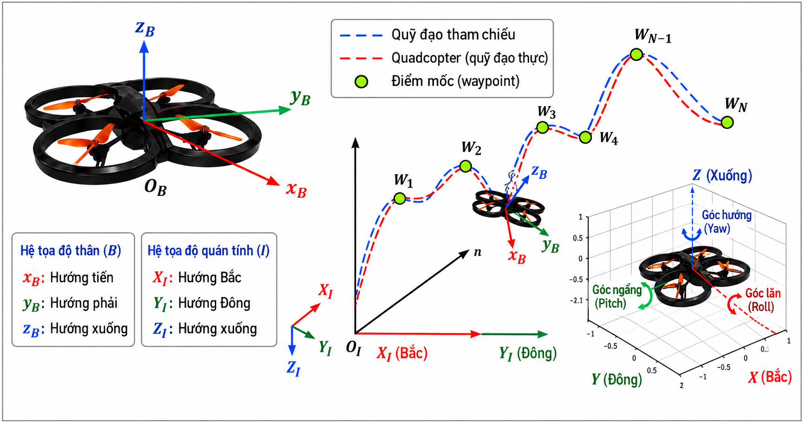

# Xây dựng bài toán

Mục tiêu điều khiển là đưa quadcopter lần lượt đi qua chuỗi waypoint $\mathcal{W} = \{\mathbf{w}_1, \ldots, \mathbf{w}_N\}$, như minh họa trong Hình [1](#fig:problem-formulation), trong không gian ba chiều. Waypoint thứ $i$, $\mathbf{w}_i = [x_i, y_i, z_i]^{\mathsf{T}}$, và vị trí của quadcopter tại thời điểm $t$, $\mathbf{p}_t = [x_t, y_t, z_t]^{\mathsf{T}}$, đều được biểu diễn trong hệ tọa độ quán tính North–East–Down (NED).

<figure id="fig:problem-formulation" data-latex-placement="H">

<figcaption>Mô hình bài toán bám quỹ đạo waypoint của quadcopter.</figcaption>
</figure>

Trong Hình [1](#fig:problem-formulation), chuyển động của quadcopter được mô tả thông qua hai hệ tọa độ: hệ tọa độ quán tính $\{I\}$ và hệ tọa độ thân $\{B\}$. Hệ tọa độ quán tính được sử dụng để mô tả vị trí và quỹ đạo bay của quadcopter trong không gian toàn cục, với các trục $X_I$, $Y_I$, và $Z_I$ lần lượt tương ứng với các hướng North, East, và Down. Trong khi đó, hệ tọa độ thân gắn trực tiếp với quadcopter gồm các trục $x_B$, $y_B$, và $z_B$, dùng để mô tả hướng chuyển động và tư thế của phương tiện.
