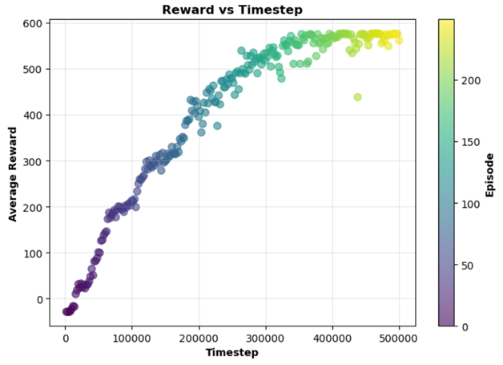

# Kết quả

Bộ điều khiển PPO được huấn luyện trên quỹ đạo hình vuông gồm 40 waypoint trong tổng số 500.000 bước thời gian. Kết quả huấn luyện trong Hình 3, cho thấy phần thưởng trung bình tăng dần theo số bước huấn luyện. Ở giai đoạn đầu, giá trị phần thưởng còn thấp do tác nhân chưa học được chính sách chưa hình thành phù hợp. Khi quá trình huấn luyện tiếp tục, phần thưởng tăng rõ rệt và đạt khoảng 500 sau gần 300.000 bước thời gian. Từ khoảng 350.000 bước trở đi, phần thưởng dần đạt ổn định trong khoảng 560–580 và cho tới cuối quá trình huấn luyện. Kết quả này cho thấy tác nhân PPO đã dần cải thiện chính sách và đạt được chính sách điều khiển phù hợp đối với nhiệm vụ huấn luyện được thiết lập.

<figure id="fig:ppo-training-result" data-latex-placement="H">

<figcaption>Kết quả huấn luyện tác nhân PPO.</figcaption>
</figure>

<figure id="fig:trajectory-comparison" data-latex-placement="!t">

<strong>(a)</strong> Bộ điều khiển PPO

<strong>(b)</strong> Phương pháp MoveOnPath

<figcaption>So sánh quỹ đạo chuyển động ba chiều của quadcopter.</figcaption>
</figure>

<figure id="fig:position-response-comparison" data-latex-placement="!t">

<strong>(a)</strong> Bộ điều khiển PPO

<strong>(b)</strong> Phương pháp MoveOnPath

<figcaption>So sánh đáp ứng vị trí theo thời gian của quadcopter.</figcaption>
</figure>

<figure id="fig:attitude-response-comparison" data-latex-placement="!t">

<strong>(a)</strong> Bộ điều khiển PPO

<strong>(b)</strong> Phương pháp MoveOnPath

<figcaption>So sánh đáp ứng góc roll, pitch và yaw của quadcopter.</figcaption>
</figure>

Sau quá trình huấn luyện, tác nhân PPO và phương pháp MoveOnPath đều được triển khai trong môi trường mô phỏng ProjectAirsim để đánh giá khả năng điều khiển quadcopter bám quỹ đạo. Hình [4](#fig:trajectory-comparison) là cho thấy cả hai đều điều khiển quadcopter hoàn thành quỹ đạo hình vuông và đi qua các waypoint theo thứ tự yêu cầu. Đối với tác nhân PPO, quỹ đạo thực tế bám sát quỹ đạo tham chiếu trên các đoạn thẳng, cho thấy tác nhân sau huấn luyện đã học chính sách điều khiển quadcopter phù hợp với nhiệm vụ bám quỹ đạo. Sai lệch chủ yếu xuất hiện tại các vị trí cần quadcopter chuyển hướng. Trong khi đó, quỹ đạo của MoveOnPath xuất hiện sai lệch và hiện tượng bo góc rõ hơn tại các vị trí cần quadcopter chuyển hướng.

Hình [5](#fig:position-response-comparison) biểu diễn đáp ứng vị trí của quadcopter theo thời gian. Với tác nhân PPO, các thành phần vị trí thay đổi nhanh hơn khi phương tiện chuyển từ một cạnh của quỹ đạo sang cạnh kế tiếp, dẫn đến quá trình hoàn thành chuỗi waypoint trong khoảng thời gian ngắn hơn. Các khoảng mà một thành phần tọa độ gần như không đổi tương ứng với quá trình phương tiện chuyển động dọc theo cạnh vuông góc với trục tọa độ đó. So với PPO, MoveOnPath có xu hướng thực hiện các quá trình chuyển tiếp chậm hơn.

Đáp ứng tư thế trong Hình [6](#fig:attitude-response-comparison) cho thấy các biến thiên chủ yếu xuất hiện tại các thời điểm quadcopter tăng tốc hoặc thay đổi hướng chuyển động. Với kết quả của tác nhân PPO, tại các vị trí chuyển hướng xuất hiện biến thiên của góc roll và pitch là tương đối lớn cùng các dao động ngắn sau quá trình chuyển tiếp. Điều này cho thấy tác nhân PPO có xu hướng tạo các lệnh vận tốc mang tính chủ động hơn nhằm nhanh chóng điều chỉnh hướng chuyển động. Mặc dù vậy, quadcopter vẫn duy trì trạng thái bay và hoàn thành toàn bộ quỹ đạo. Do đó, kết quả cho thấy khả năng đáp ứng nhanh của PPO đi kèm với sự đánh đổi về độ mượt của chuyển động, đặc biệt tại các vị trí thay đổi hướng. Đặc điểm này liên quan đến hàm phần thưởng hiện tại, trong đó chưa có thành phần trực tiếp hạn chế mức biến thiên của lệnh vận tốc hoặc tư thế.

**Bảng 2. So sánh kết quả giữa MoveOnPath và PPO**

| Bộ điều khiển | Thời gian (s) | RMSE (m) | MAE (m) | RMSE x (m) | RMSE y (m) | RMSE z (m) |
|---|---:|---:|---:|---:|---:|---:|
| MoveOnPath | 36.34 | 0.186 | 0.160 | 0.088 | 0.090 | 0.137 |
| PPO | 17.34 | 0.105 | 0.073 | 0.068 | 0.031 | 0.074 |

Bảng [2](#tab:baseline-ppo-comparison) trình bày các thông số kết quả của tác nhân PPO và phương pháp tham chiếu MoveOnPath. Tác nhân PPO hoàn thành quỹ đạo trong $17.34~\mathrm{s}$, trong khi phương pháp tham chiếu cần $36.34~\mathrm{s}$, tương ứng với mức giảm thời gian khoảng $52.3\%$. Đồng thời, sai số bám quỹ đạo của PPO cũng thấp hơn, với RMSE giảm từ $0.186~\mathrm{m}$ xuống $0.105~\mathrm{m}$ và MAE giảm từ $0.160~\mathrm{m}$ xuống $0.073~\mathrm{m}$, tương ứng mức giảm khoảng $43.5\%$ và $54.4\%$. Kết quả này cho thấy trong điều kiện mô phỏng được khảo sát, khả năng đáp ứng nhanh hơn của tác nhân PPO không đi kèm với sự gia tăng sai số bám quỹ đạo.

Xét theo từng trục tọa độ, PPO đạt RMSE thấp hơn phương pháp tham chiếu trên cả ba phương. Cụ thể, $\mathrm{RMSE}_x$ giảm từ $0.088~\mathrm{m}$ xuống $0.068~\mathrm{m}$, $\mathrm{RMSE}_y$ giảm từ $0.090~\mathrm{m}$ xuống $0.031~\mathrm{m}$ và $\mathrm{RMSE}_z$ giảm từ $0.137~\mathrm{m}$ xuống $0.074~\mathrm{m}$. Mức cải thiện rõ nhất xuất hiện trên trục $y$, trong khi sai số trên trục $z$ vẫn là thành phần lớn nhất đối với PPO. Nhìn chung, các kết quả trong Bảng [2](#tab:baseline-ppo-comparison) cho thấy tác nhân PPO đã học được chính sách sinh lệnh vận tốc có khả năng bám quỹ đạo hiệu quả hơn phương pháp tham chiếu trong bài toán được xem xét.
